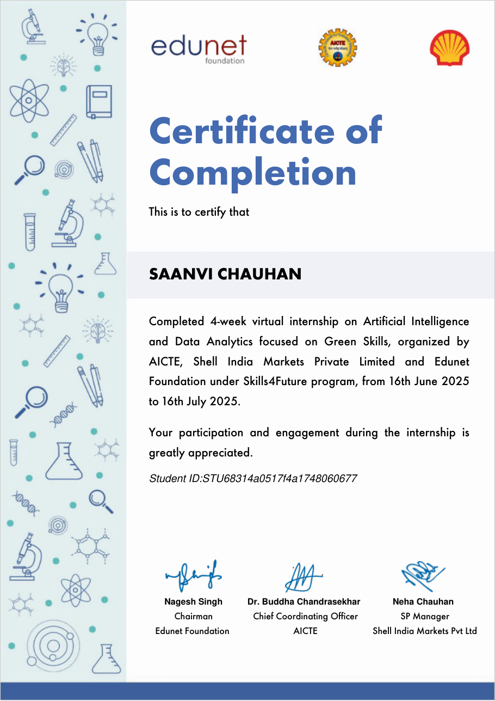

# Water Quality Prediction

An end-to-end ML pipeline that predicts six water-quality parameters for a monitoring station in a given year. It is trained on 2,861 records from 22 monitoring stations (2000–2021) and served as an interactive Streamlit app.

Predicted parameters: dissolved oxygen (O2), nitrate (NO3), nitrite (NO2), sulphate (SO4), phosphate (PO4) and chloride (CL).

## Internship

I built this project during the **AI and Data Analytics virtual internship (Green Skills)**, run by AICTE, Shell India Markets Pvt. Ltd. and Edunet Foundation under the Skills4Future program, 16 June – 16 July 2025.

[](certificate/shell-edunet-aicte-internship-certificate.pdf)

Certificate: [PDF](certificate/shell-edunet-aicte-internship-certificate.pdf)

## Features

- Pick one of the 22 monitoring stations and a year to get predicted levels for all six parameters at once
- One model handles all six targets (`MultiOutputRegressor` around `RandomForestRegressor`)
- The app trains the model on the bundled CSV at startup and caches it, so there is no model file to download or keep in sync
- `evaluate.py` reproduces the held-out metrics below in one command

## Tech stack

Python · pandas · scikit-learn · Streamlit · Jupyter

## Pipeline

1. **Parse**: read `data/water_quality.csv` (2,861 semicolon-separated rows: `id`, `date`, `NH4`, `BSK5`, `Suspended`, `O2`, `NO3`, `NO2`, `SO4`, `PO4`, `CL`), parse `date` and extract `year`
2. **Clean**: drop rows with a missing value in any of the six targets, leaving 2,780 rows
3. **Encode**: one-hot encode the station `id` (station 1 is the baseline column) and keep `year` as a numeric feature
4. **Train**: 80/20 train/test split (`random_state=42`), multi-output Random Forest with 20 trees
5. **Evaluate**: MSE, MAE and R² per parameter on the held-out 20% (556 rows)
6. **Serve**: Streamlit app retrains on all rows and predicts from a station and year

The shared steps live in `pipeline.py`, which both `app.py` and `evaluate.py` import.

## Results

Held-out 20% test split, from `python evaluate.py` (identical to the notebook output):

| Parameter | MSE | MAE | R² |
|---|---|---|---|
| O2 | 22.56 | 2.57 | -0.03 |
| NO3 | 21.47 | 2.97 | 0.43 |
| NO2 | 14.47 | 0.55 | -107.36 |
| SO4 | 2922.62 | 16.26 | 0.29 |
| PO4 | 0.37 | 0.28 | 0.34 |
| CL | 38384.59 | 31.48 | 0.71 |

What these numbers show:

- Station and year alone explain chloride well (R² 0.71) and nitrate partly (R² 0.43); sulphate and phosphate less so.
- For dissolved oxygen the model does no better than predicting the mean (R² ≈ 0).
- The NO2 R² is dominated by outliers: the training split contains a value of 109 while the test split's maximum is 6, so a few trees predict very large values. NO2 needs outlier handling or a log transform before this model is useful for it.
- Random forests cannot extrapolate, so any year after 2021 gets the 2021 prediction.

Possible next steps: add seasonality (`month`), use the other measured parameters as inputs, treat outliers, and compare against a per-station mean baseline.

## Project structure

```
water-quality-prediction/
├── app.py                          # Streamlit app (trains and caches the model at startup)
├── pipeline.py                     # data loading, encoding and model shared by app and evaluation
├── evaluate.py                     # reproduces the held-out test metrics
├── water_quality_prediction.ipynb  # EDA, training and evaluation
├── data/
│   └── water_quality.csv           # station measurements
├── certificate/                    # internship certificate of completion
├── tests/
│   └── test_app.py                 # headless smoke test of the app
├── requirements.txt
└── README.md
```

## Run locally

```bash
git clone https://github.com/saanvi4996/water-quality-prediction.git
cd water-quality-prediction
python -m venv venv
venv\Scripts\activate          # Windows
# source venv/bin/activate     # macOS / Linux
pip install -r requirements.txt
streamlit run app.py
```

The app opens at http://localhost:8501.

Reproduce the metrics:

```bash
python evaluate.py
```

Smoke test (runs the app headless and makes one prediction):

```bash
pip install pytest
pytest
```

## Deploy (Streamlit Community Cloud)

1. Push the repository to GitHub.
2. At [share.streamlit.io](https://share.streamlit.io) choose **New app**, select this repository and branch, and set the main file to `app.py`.
3. No secrets are needed. The dataset is in the repository and the model trains in a few seconds on first load.
